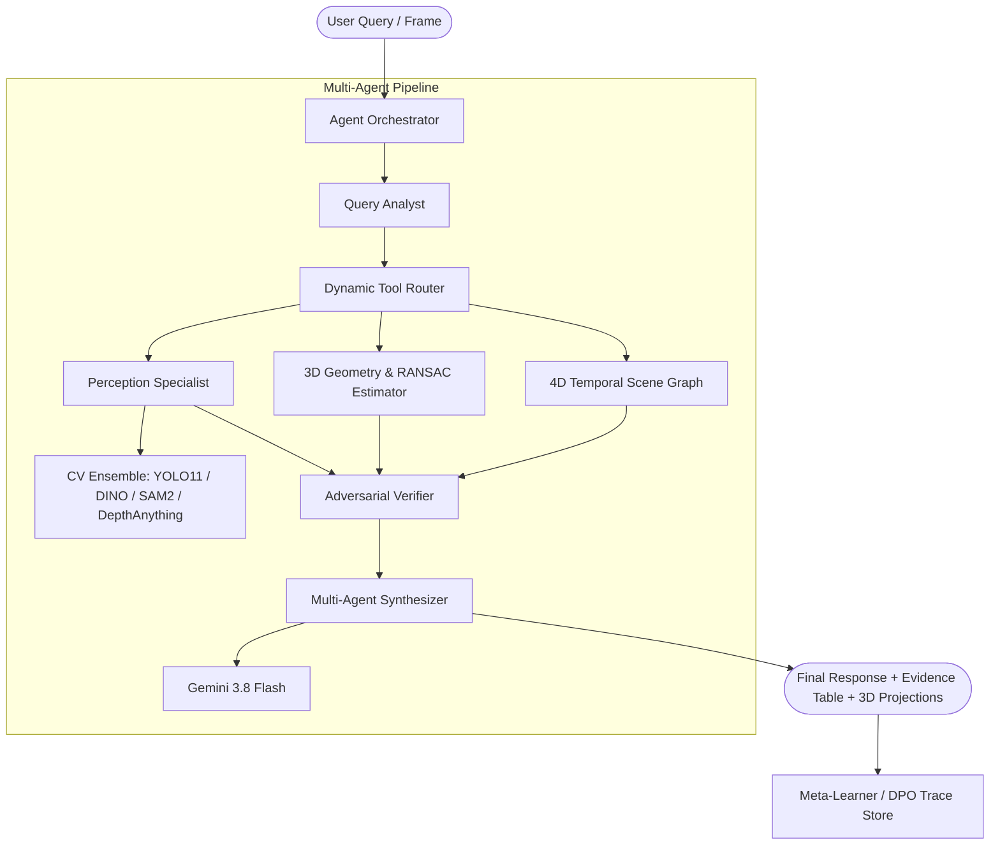

# OmniVision Agent Studio (v3)

<div align="center">


**Research-grade, zero-shot visual agent studio coupling multi-agent program synthesis with real-time perception models, 3D metric spatial estimation, 4D scene graphs, and meta-learning.**

[Overview](#-overview) •
[Key Features](#-key-features) •
[Architecture](#-system-architecture) •
[Getting Started](#-getting-started) •
[API Reference](#-api-endpoints) •
[Benchmarks](#-benchmark-suite) •
[License](#-license)

</div>

---

## 🌟 Overview

**OmniVision Agent** is a full-stack, state-of-the-art vision-reasoning system designed to solve complex zero-shot visual queries across single images and video streams. Instead of relying purely on end-to-end multimodal heuristics, OmniVision decomposes high-level reasoning tasks through a modular agent orchestrator:

1. **Query Analyst**: Deconstructs user queries into explicit spatial, geometric, OCR, and semantic sub-goals.
2. **Perception Ensemble**: Executes zero-shot detection, open-vocabulary grounding, metric depth estimation, and pose tracking.
3. **Adversarial Verifier**: Validates findings, filters spatial hallucinations, and audits evidence.
4. **Program Synthesizer**: Unifies observations into structured natural-language deductions and execution traces.
5. **Interactive 3D/4D Space**: Projects 2D bounding boxes into metric 3D point clouds with ground-plane RANSAC geometry and temporal tracking.

---

## 🚀 Key Features

### 👁️ Real-Time Vision & 3D Spatial Studio
- **Dual Visual Workspace**: Synchronized side-by-side display of 2D bounding box detections and interactive 3D metric point clouds.
- **Three.js Metric Visualizer**: Real-time 3D camera frustum, point clouds, metric distance measurement, and ground-plane RANSAC grid overlay.
- **Flexible Input Modalities**: Live webcam streaming, image uploads, or instant preset benchmark feeds.

### 🧠 Multi-Agent Vision Pipeline
- **Gemini 3.8 Flash Integration**: High-throughput reasoning and zero-shot deduction using Google Gen AI SDK.
- **SOTA Perception Models Supported**:
  - `YOLO11` / `RT-DETR` Ensemble (High-speed object localization)
  - `Grounding DINO 1.5` (Open-vocabulary detection)
  - `Segment Anything 2 (SAM 2)` (Promptable mask segmentation)
  - `Depth Anything V2 Metric` (Metric depth prediction)
  - `PaddleOCR v4` (Fine-grained multilingual text spotting)
  - `SigLIP 2` / `CLIP` (Zero-shot embedding similarity)
  - `RTMPose` (Keypoint & human action estimation)

### 🕸️ 4D Temporal Scene Graph
- **Persistent Spatial-Temporal Tracking**: Tracks instances across sequential frames with unique tracking IDs.
- **Relational Spatial Geometry**: Computes pairwise geometric predicates (`left_of`, `right_of`, `in_front_of`, `supports`, `touching`, `near`).

### ✏️ Ground Truth Annotation Studio
- **Interactive Annotation Tools**: Draw and edit 2D bounding boxes, assign semantic categories, and tag depth keypoints directly in the browser.
- **Dataset Persistence**: Export and save ground-truth annotations to backend datasets for supervised validation.

### 🔬 Meta-Learning & DPO Pipeline
- **Execution Traces**: Deep inspection into internal thoughts, tool calls, and latency profiles.
- **DPO Dataset Generator**: Automatically formats preference pairs (winning vs. losing reasoning paths) for Direct Preference Optimization (DPO).
- **Dynamic Tool Router Weights**: Inspect and adjust agent tool preference coefficients in real-time.

---

## 🏗️ System Architecture



---

## 🛠️ Tech Stack

- **Frontend**: [React 19](https://react.dev/), [TypeScript](https://www.typescriptlang.org/), [Vite](https://vitejs.dev/), [TailwindCSS v4](https://tailwindcss.com/)
- **3D Graphics**: [Three.js](https://threejs.org/) (Custom WebGL shader point-clouds & RANSAC ground planes)
- **Icons & Animations**: [Lucide React](https://lucide.dev/), [Motion](https://motion.dev/)
- **Server**: [Express](https://expressjs.com/) (Embedded with Vite middleware)
- **AI / LLM**: [@google/genai](https://www.npmjs.com/package/@google/genai) (Google Gemini 3.8 Flash)

---

## 💻 Getting Started

### Prerequisites
- **Node.js**: v18.0.0 or later (v20+ / v24+ recommended)
- **npm** or **bun**
- A **Google Gemini API Key** from [Google AI Studio](https://aistudio.google.com/app/apikey)

### Installation

1. **Clone the repository:**
   ```bash
   git clone https://github.com/Kareem-1010/OmniVision-Agent-Studio-Zero-Shot-Visual-agent.git
   cd OmniVision-Agent-Studio-Zero-Shot-Visual-agent
   ```

2. **Install dependencies:**
   ```bash
   npm install
   ```

3. **Configure Environment Variables:**
   Copy `.env.example` to `.env`:
   ```bash
   cp .env.example .env
   ```
   Open `.env` and add your Gemini API key:
   ```env
   GEMINI_API_KEY="your_gemini_api_key_here"
   APP_URL="http://localhost:3000"
   ```

4. **Start the Development Server:**
   ```bash
   npm run dev
   ```
   Open [http://localhost:3000](http://localhost:3000) in your browser.

---

## 🧪 Available Scripts

| Command | Action |
|---|---|
| `npm run dev` | Starts the Express server with live Vite HMR on `http://localhost:3000` |
| `npm run build` | Compiles client assets to production-ready `dist/` |
| `npm run preview` | Previews the built production client locally |
| `npm run lint` | Runs TypeScript type-checking across all files without emitting |

---

## 🔌 API Endpoints

The backend server provides a RESTful API:

| Method | Endpoint | Description |
|---|---|---|
| `GET` | `/api/health` | Healthcheck reporting server status and available models |
| `GET` | `/api/benchmarks` | Retrieves standard evaluation chains and presets |
| `POST` | `/api/agent/run` | Executes the complete multi-agent reasoning pipeline |
| `POST` | `/api/perception/detect` | Runs dedicated CV specialist detection and grounding |
| `GET` | `/api/agent/meta-learn/traces` | Fetches historical execution and latency traces |
| `GET` | `/api/agent/meta-learn/dpo` | Exports paired preference trajectories for DPO alignment |
| `GET` | `/api/agent/meta-learn/router` | Fetches current dynamic tool router weights |
| `GET` | `/api/agent/meta-learn/annotations` | Lists saved ground-truth dataset annotations |
| `POST` | `/api/agent/meta-learn/annotations` | Persists user-labeled ground truth annotations |

---

## 📊 Benchmark Suite

OmniVision Agent includes pre-configured benchmark scenarios for evaluating complex visual reasoning:
- **Autonomous Driving & Traffic Flow**: Multi-vehicle spatial tracking and clearance estimation.
- **Industrial Safety Compliance**: PPE detection, proximity-to-hazard reasoning.
- **Dense Medical / Lab Analysis**: High-precision anomaly detection and object counting.
- **Robotic Bin Picking**: 3D geometric grasp plane computation and bounding cube extraction.

---

## 📄 License

This project is licensed under the Apache 2.0 License. See the [LICENSE](LICENSE) file for details.
