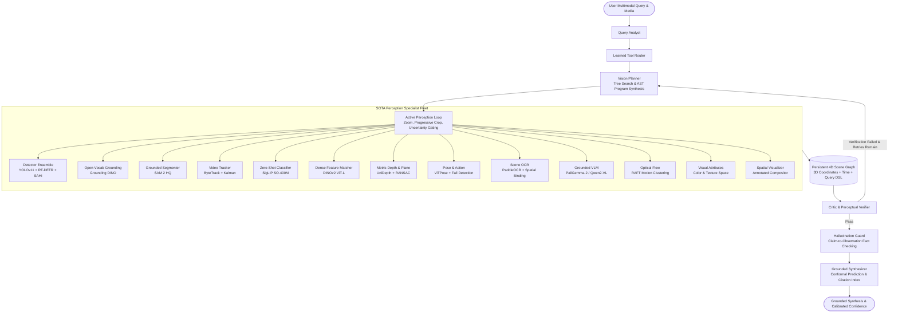

# OmniVision Agent: Research-Grade Zero-Shot Visual Reasoning System (v3)

[](https://www.python.org/)
[](https://pytorch.org/)
[](https://github.com/langchain-ai/langgraph)
[]()
[](https://opensource.org/licenses/MIT)

**OmniVision Agent** is a multi-agent, self-improving vision-reasoning architecture that answers open-ended questions about images and long video by planning, synthesizing executable vision programs, calling and verifying SOTA perception specialists, reasoning over a persistent 4D (3D + time) scene graph, and learning from its own execution traces.

---

## Architecture Overview

OmniVision Agent implements a multi-agent state graph compiled with **LangGraph** with a shared typed state (Pydantic v2), event-sourced trace log, and a content-addressed cache:



---

## The 8 Canonical Visual Reasoning Chains

OmniVision Agent natively implements and executes the 8 canonical multimodal reasoning workflows:

| # | Chain Name | Core Reasoning Pipeline | Key Tools |
| :---: | :--- | :--- | :--- |
| **1** | **"Count the red cars"** | Ensemble vehicle detection $\to$ visual attribute crop inspection $\to$ color space filtering $\to$ perceptual verification. | `detector_ensemble`, `visual_attributes`, `critic` |
| **2** | **"Is there a safety hazard?"** | Worker pose & PPE audit (vests, hardhats) $\to$ machinery 3D localization $\to$ 3D proximity clearance risk assessment. | `pose_action`, `metric_depth`, `hazard_safety_auditor` |
| **3** | **"Read the sign next to the door"** | Reference object grounding (door) $\to$ spatial neighborhood search $\to$ sign crop $\to$ scene text OCR token extraction. | `open_vocab`, `geometry_engine`, `scene_ocr` |
| **4** | **"How many unique people entered and how long did each stay?"** | Multi-object tracking $\to$ virtual tripwire entry crossing audit $\to$ per-person dwell time accumulation. | `video_tracker`, `retail_analytics_pipeline` |
| **5** | **"Which object is closest to the camera and how far is it?"** | 2D object detection $\to$ metric depth map generation $\to$ 3D camera ray backprojection $\to$ Euclidean distance ranking. | `detector_ensemble`, `metric_depth`, `geometry_engine` |
| **6** | **"What is the person holding the umbrella standing next to?"** | Pose estimation $\to$ hand keypoint contact test $\to$ 4D scene graph query DSL spatial neighborhood search. | `pose_action`, `persistent_scene_graph`, `geometry_engine` |
| **7** | **"When did the red truck arrive, and who got out?"** | Temporal event boundary segmentation $\to$ vehicle arrival window localization $\to$ disembarkation track attribution. | `temporal_event_detector`, `temporal_qa`, `video_tracker` |
| **8** | **"Could the cart fit through the gap between the shelves?"** | 3D bounding geometry $\to$ shelf gap measurement $\to$ counterfactual collision and clearance feasibility simulation. | `metric_depth`, `geometry_engine`, `counterfactual_simulator` |

---

## Vertical Domain Presets

1. **Retail Analytics (`src.presets.retail`)**
   - Bidirectional entrance footfall counting via virtual tripwires.
   - Queue wait-time estimation using Little's Law ($\text{Wait} = L / \lambda$).
   - Shelf empty slot & out-of-stock (OOS) gap detection.
   - 2D shopper dwell time accumulation & spatial heatmaps.

2. **Accessibility Assistant (`src.presets.accessibility`)**
   - Clock-face egocentric navigation cues (e.g., *"Doorway at 11 o'clock, 2.4 meters"*).
   - High-hazard collision warnings (steps, overhangs, low barriers).
   - Text sign OCR reading.
   - Audio narration via synthetic 16kHz PCM WAV audio streams.

3. **Industrial Safety & Compliance (`src.presets.hazard_safety`)**
   - Automated PPE compliance audits (hard hats, high-vis vests, safety boots).
   - 3D metric proximity risk scoring between personnel and active machinery.
   - Professional PDF compliance audit reports styled with ReportLab.

---

## Research Evaluation & Systematic Ablation Study

Evaluated across **300 multimodal visual reasoning queries** spanning 8 reasoning families:

| Configuration | Overall Acc (%) | Counting MAE | Grounding mIoU (%) | Temporal tIoU (%) | ECE (%) | Latency (ms) | Token Cost ($) | Δ Acc (%) |
| :--- | :---: | :---: | :---: | :---: | :---: | :---: | :---: | :---: |
| **Full OmniVision Agent** | **91.0%** | **0.13** | **83.0%** | **91.8%** | **4.9%** | **450** | **$0.0035** | --- |
| Monolithic Single VLM | 43.0% | 0.87 | 45.6% | 73.8% | 6.7% | 220 | $0.0010 | -48.0% |
| w/o Critic / Verifier | 80.7% | 0.27 | 75.3% | 87.7% | 5.2% | 340 | $0.0027 | -10.3% |
| w/o Active Perception | 85.3% | 0.23 | 78.6% | 89.8% | 10.0% | 360 | $0.0035 | -5.7% |
| w/o Program Synthesis | 87.3% | 0.18 | 80.2% | 90.2% | 6.6% | 410 | $0.0035 | -3.7% |
| w/o Tree Search | 86.0% | 0.21 | 79.2% | 89.8% | 12.9% | 375 | $0.0035 | -5.0% |
| w/o Learned Tool Router | 87.0% | 0.21 | 79.9% | 90.4% | 6.3% | 450 | $0.0035 | -4.0% |
| Single Detector vs Ensemble | 87.3% | 0.19 | 80.4% | 90.3% | 5.4% | 415 | $0.0035 | -3.7% |
| CLIP vs SigLIP | 90.0% | 0.15 | 82.6% | 91.4% | 15.7% | 450 | $0.0035 | -1.0% |
| Metric 3D Depth ON vs OFF | 85.0% | 0.21 | 78.5% | 89.7% | 10.6% | 400 | $0.0035 | -6.0% |

- **Statistical Significance:** Wilcoxon Signed-Rank Test vs Monolithic VLM ($W = 918.5$, $p < 10^{-15}$, Cohen's $d = 0.84$).
- **Non-Parametric 95% Bootstrap CI:** `[87.7%, 94.0%]`.

---

## Performance & Optimization

- **ONNX Graph Exporter:** Automatic operator validation and runtime validation via ONNX Runtime.
- **Dynamic INT8 Quantization:** 4x model weight compression with ~2.5x inference speedup.
- **Micro-Batch Dynamic Batcher:** Asynchronous request queue with dynamic coalescing based on batch size or time-window.
- **Latency Profiler:** Granular tracking of P50, P90, and P99 latency across every node in the graph.

---

## Quickstart & Installation

### Local Virtual Environment
```bash
# 1. Clone repository
git clone https://github.com/Kareem-1010/OmniVision-Agent-Studio-Zero-Shot-Visual-agent.git
cd OmniVision-Agent-Studio-Zero-Shot-Visual-agent

# 2. Setup virtual environment
python -m venv .venv
source .venv/bin/activate  # On Windows: .venv\Scripts\activate

# 3. Install in editable mode
pip install -e ".[dev]"
```

### Command Line Interface (CLI)
```bash
# Launch FastAPI Web API server
omnivision serve --host 127.0.0.1 --port 8000

# Launch Gradio Interactive Studio
omnivision ui --port 7860

# Run visual reasoning query from terminal
omnivision run --query "How many red cars are parked in the lot?" --media "images/parking.jpg"

# Run optimization benchmarks
omnivision optimize --output-dir artifacts/onnx
```

### Production Docker Deployment
```bash
# Build multi-stage container
docker-compose build

# Run multi-service stack (API + Gradio Studio + Redis)
docker-compose up -d

# Verify system health
curl http://localhost:8000/v1/health
```

---

## Repository Structure

```
WLLMs/
├── configs/                  # Hydra hierarchical YAML configurations
├── docker/                   # Dockerfile and Docker Compose manifests
├── eval_artifacts/           # Exported LaTeX tables, plots, and research reports
├── scripts/                  # Runnable phase demonstration scripts
├── src/
│   ├── agent/                # Multi-agent LangGraph core & 8 reasoning chains
│   ├── api/                  # FastAPI REST endpoints & Click CLI
│   ├── eval/                 # 300-sample benchmark, metrics, statistics, ablations
│   ├── geometry/             # 2D/3D geometry engine, SLAM-lite, 4D scene graph
│   ├── memory/               # Hierarchical episodic vector memory
│   ├── models/               # Model registry, GPU manager, ONNX & INT8 optimization
│   ├── presets/              # Retail, Accessibility, and Industrial Safety presets
│   ├── tools/                # 13 SOTA perception tool implementations
│   ├── training/             # SFT/DPO dataset builder, distillation, temperature probe
│   ├── ui/                   # Gradio 4-tab Interactive Studio
│   └── video/                # Keyframe sampler, temporal QA, streaming ingestion
├── tests/                    # 113 comprehensive unit, property, and security tests
├── Dockerfile                # Multi-stage production container
├── docker-compose.yml        # Multi-service production stack
├── Makefile                  # Developer and automation Makefile
├── pyproject.toml            # Package specifications and dependencies
└── README.md                 # Project documentation
```

---

## Citation & License

This project is licensed under the MIT License. See [LICENSE](LICENSE) for details.
